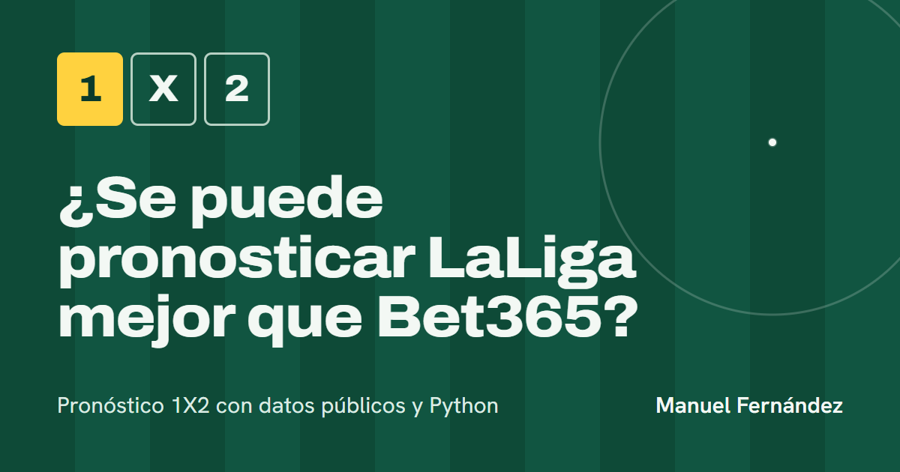

# Pronóstico LaLiga

**[Ver la página del proyecto](https://manuferrod.github.io/pronostico-laliga/)**: el pronóstico de la próxima jornada, los resultados de 13 temporadas y un buscador con todos los partidos.

Un modelo pronostica local, empate o visitante en cada partido de Primera y se compara, partido a partido, con apostar siempre al favorito de Bet365.

## Resultados

De 2014/15 a 2026/27, con datos hasta el 23 de noviembre de 2026. Los de la página se actualizan cada jornada.

| 4.689 partidos | Modelo | Favorito de Bet365 |
|---|---:|---:|
| Partidos acertados | **54,8 %** | 54,2 % |
| Rentabilidad por apuesta | **+0,4 %** | −2,7 % |
| Unidades, apostando 1 por partido | **+17,6** | −124,4 |
| Pérdida logarítmica (menos es mejor) | 0,978 | **0,958** |

La ventaja sobre el favorito es de **+3,03 puntos** de rentabilidad, con un intervalo del 95 % entre +1,09 y +4,96.

### Cómo se mide

- **Nunca ve el futuro.** Cada partido se pronostica con un modelo entrenado solo con los anteriores.
- **Mismos partidos y mismas cuotas** para el modelo y para Bet365: las de apertura.
- **Se apuesta a todo**, una unidad por partido.
- Es una simulación con datos históricos y las variables se seleccionaron con estas mismas temporadas. No es una recomendación para apostar.

## Cómo funciona

1. **Extracción.** Resultados y cuotas (football-data), goles esperados (Understat), estadística de partido (SofaScore), nivel de cada club (ClubElo) y valor de plantilla (Transfermarkt).
2. **Limpieza y variables.** La estadística se convierte en rachas, promedios y tendencias, siempre anteriores al partido.
3. **Preprocesado.** Se comparan los dos equipos, se tratan los huecos y queda una fila por partido.
4. **Modelado.** Regresión logística multinomial, reentrenada antes de cada fecha con los 1.520 partidos anteriores (cuatro temporadas). Los 380 últimos pesan el triple.
5. **Presentación.** Lee lo que publica el modelo, comprueba que las cifras coinciden y escribe la página.

El modelo usa 8 variables: dos probabilidades de la cuota (local y empate), la diferencia de goles reciente del local, el rendimiento relativo del visitante, la diferencia de puntos recientes, las ocasiones claras concedidas por el visitante, los toques del local en el área rival y la nota media de SofaScore del local.

## Qué hay aquí

| Archivo | Contenido |
|---|---|
| `docs/` | la página publicada |
| `PREPROCESADO_trabajo.ipynb` | paso 3 |
| `MODELADO_trabajo.ipynb` | paso 4: validación, pronóstico y evaluación |
| `PRESENTACION_trabajo.ipynb` | paso 5 |

Los datos y los cuadernos que los descargan no se publican, así que los cuadernos se pueden leer con sus resultados, pero no ejecutar desde aquí.

Hecho con Python, pandas y scikit-learn. La página es HTML, CSS y JavaScript sin librerías.

---

**Manuel Fernández** · [LinkedIn](https://www.linkedin.com/in/manuel-fernandez-rodriguez/) · [GitHub](https://github.com/manuferrod)

Los escudos pertenecen a sus clubes. Bet365 es una marca de su propietario y no tiene relación con este trabajo.
